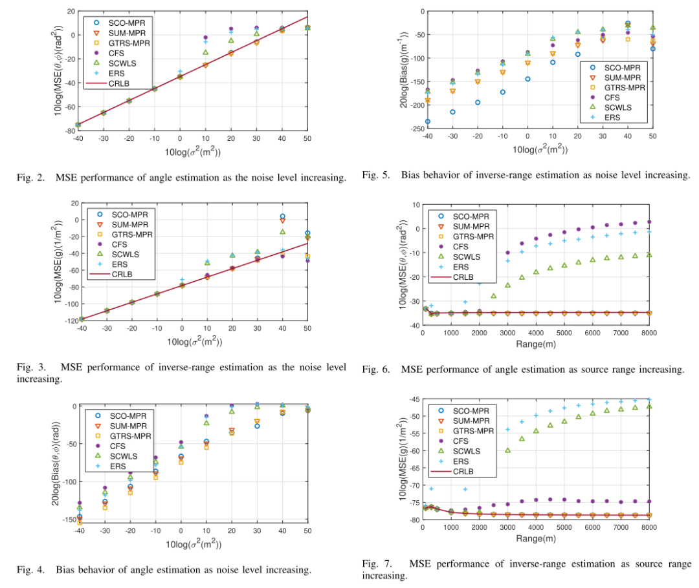
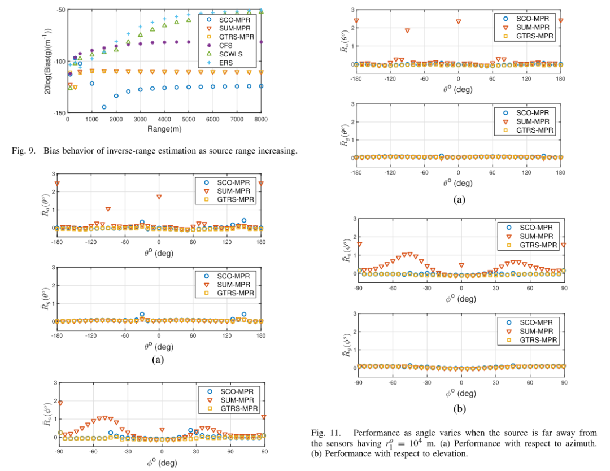
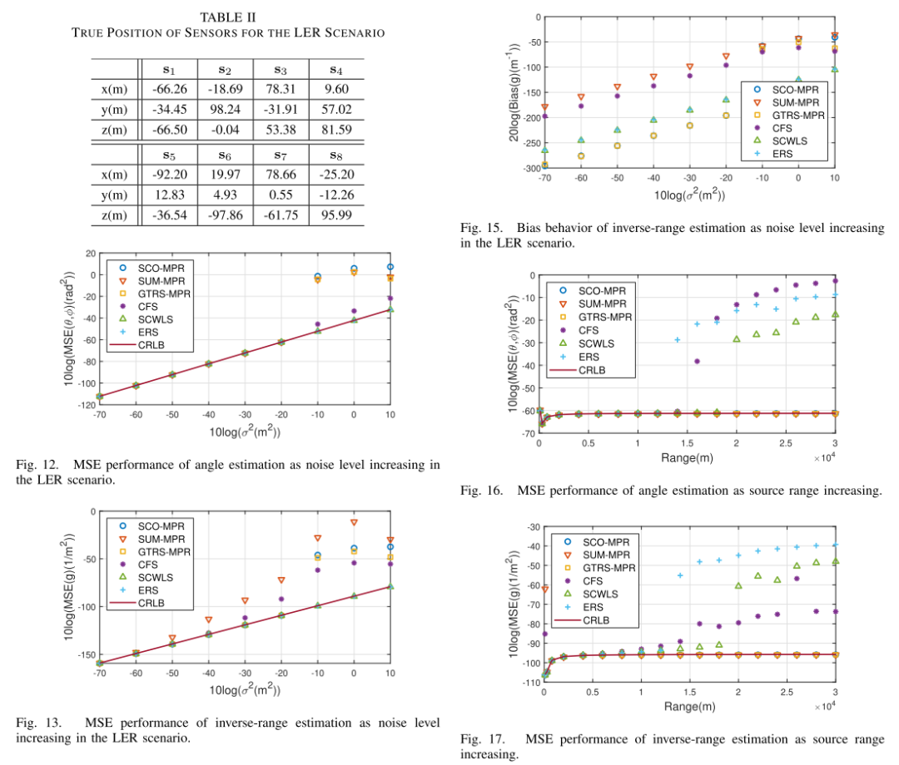
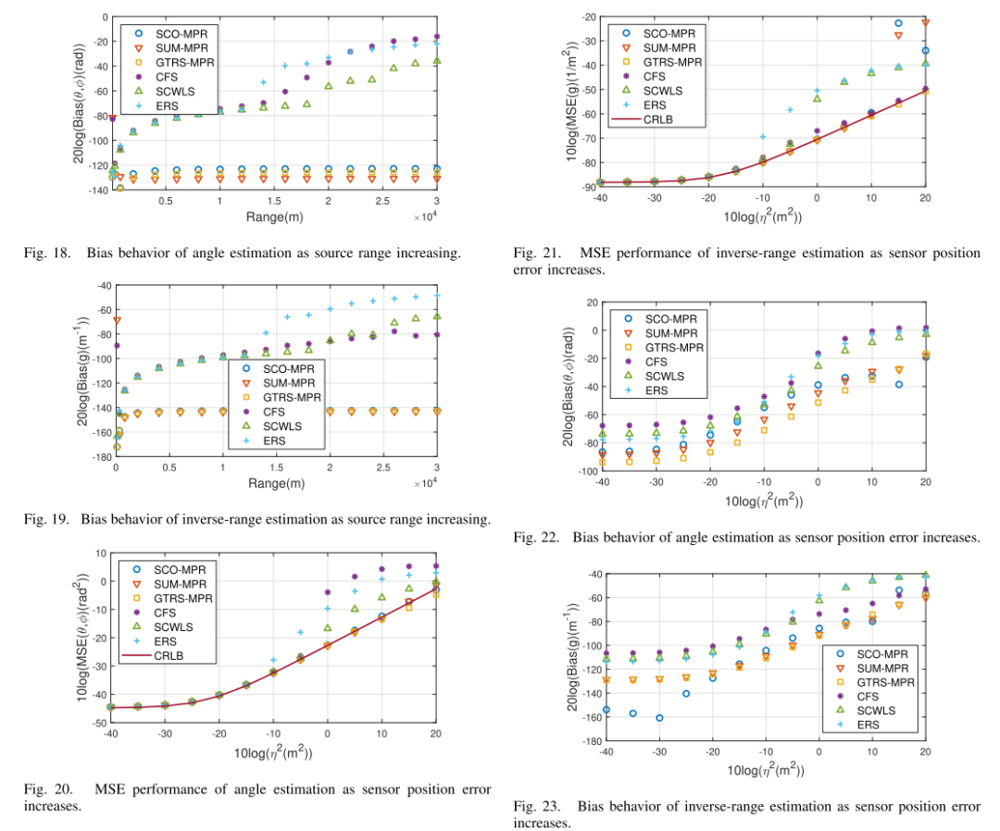
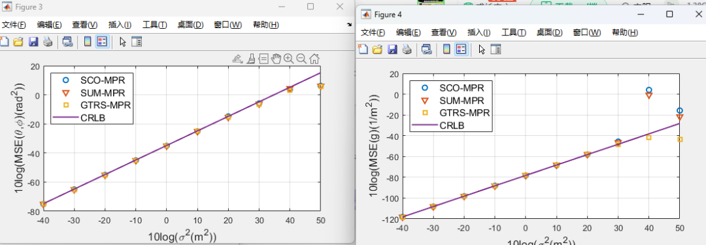
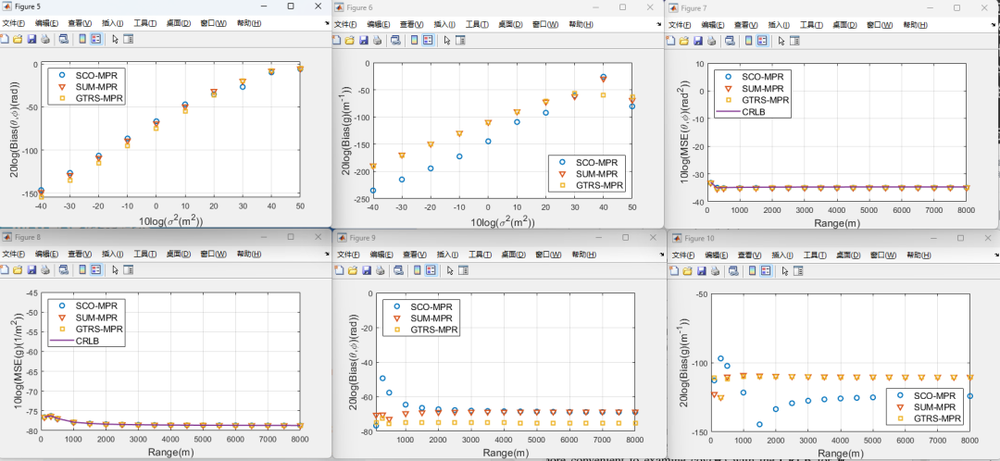

# [TDOA] Computational Attraction and Robust Position Estimation for IoT Devices Location Tracking [with MATLAB Code]

In wireless communication, autonomous driving systems, global navigation satellite systems (GNSS), and the Internet of Things (IoT), localization has been widely studied [1]-[13]. With the development of the latest generation of communication technologies, 5G, location information is crucial for the Internet of Things network [1]-[7]-[14]-[17].

The methods used to locate objects can be categorized based on the measurement used. [2019 - 09 - 19][2019 - 09][When the object to be located is mobile, frequency difference of arrival (FDOA) [30]-[32], Doppler shift [33]-[35], and multipath effects are involved. Among these measurements, Time Difference of Arrival (TDOA) is a popular choice for locating a stationary object, balancing performance and system complexity. It typically has higher capture accuracy than AOA and RSS, resulting in better positioning performance [36]-[37]. This method only requires sensor synchronization between each other, without the need for TOA synchronization with the target, thus reducing system complexity and suitability for non-cooperative positioning. One major limitation of TDOA localization is that it requires good clock synchronization between sensors, often better than what GPS can achieve.

Due to the highly nonlinear relationship between TDOA measurement values and target positions, obtaining target positions from TDOA measurements is an important and challenging process. The maximum likelihood (ML) estimation is the best estimate theoretically for achieving optimal positioning accuracy [38]. Due to the nonlinear relationship, the ML cost function has a multi-peak surface, and it must rely on numerical exhaustive search or iterative steepest descent to obtain solutions.
A compelling and practical alternative is closed-form position estimation. It avoids the high computational complexity of exhaustive search, eliminates the local convergence issues of the steepest descent method, and can achieve optimal performance under certain reasonable conditions. A well-known closed-form solution is Two-Stage Weighted Least Squares (TSWLS) [39], which is simple to implement but achieves Gaussian noise Cramer-Rao Lower Bound (CRLB) performance effectively when the noise level is moderate. Subsequent research [40] improved TSWLS and developed two bias reduction (BR) methods. Both TSWLS and BR estimators require at least N+2 sensors for object localization in a unique coordinate space in N dimensions. The paper [41] proposed a method to eliminate the auxiliary variables in TSWLS and reduced the minimum number of sensors needed to N+1. Large Elevation Radius (LER) [18], [41] scenarios refer to situations where all TDOA are close to zero. This occurs when the source is close to the center of the sensor distribution circle (2-D) or sphere (3-D), or when the source is far from the sensors. The study [18] derived positioning solutions for LER scenarios where both TSWLS and BR cannot operate normally. In addition to TSWLS and its variants, Multidimensional Scaling (MDS) is another positioning technique [31], [42], [43]. Some MDS-based methods [31], [42] can achieve optimal CRLB performance and may have higher noise tolerance than TSWLS.
All these solutions are designed to locate objects with unique coordinates when they are not far from the sensor. If this is not the case, they will be unable to produce reasonable position estimates near the object. This is due to the fundamental limitations of localization, which is that range becomes unrecognizable as the target moves away from the sensor. In such cases, only by using array processing techniques [44]-[47] can the direction of arrival (DOA) of the object be obtained. To assess the quality of the closed-form solution and the reliability of using array processing techniques, it is necessary to know whether the object is in close or far field relative to the sensor. 
The effective positioning of various devices is a fundamental element in the management of IoT devices and their development, including indoor positioning [6]-[8], wireless sensor networks (WSN) [9]-[10], [48], and vehicle positioning and tracking [11]-[13], [49]. Moreover, positioning plays a crucial role in assisting IoT WSNs in performing many important tasks, such as distributed detection for surveillance [50]. The use of position estimation methods in literature requires knowledge about whether the device is close to the sensor used for coordinate positioning or far from the sensor used for DOA estimation. In IoT, this knowledge is often unavailable because devices can appear anywhere, especially in dynamic scenarios where they can approach or move away from the sensor. Positioning without such knowledge would enhance robustness of device location and broaden the application of IoT.
To achieve robustness regarding device position, the concept of Modified Polar Representation (MPR) for position was introduced in [19], [52], and [53]. MPR provides a model framework for positioning algorithms. If the device is close to the sensor, it produces a coordinate position, and if the device is far from the sensor, it produces DOA. The initial research [19], [53] developed an ML estimator (MLE) using semidefinite relaxation (SDR) as an initial guess to start Gaussian-Newton iterations. To improve computational efficiency and eliminate the dependence on initialization, [54] transformed the TDOA localization problem in MPR into constrained optimization and developed two closed-form solutions. One uses continuous unconstrained minimization (SUM), which is computationally simple, and the other is suitable for generalized trust region subproblem (GTRS), which can tolerate a large amount of measurement noise. Although SUM and GTRS generally perform well, SUM solutions require at least N + 2 sensors and cannot work in LER scenarios because TSWLS. The wartime GTRS solution does not have these limitations but has much larger computations and requires feature decomposition.
Industrial IoT technology provides an opportunity for the creation of unmanned large warehouses. In these warehouses, Automated Guided Vehicles (AGV) and Unmanned Aerial Vehicles (UAVs) form a network to work together to handle goods. In IoT applications, it is crucial to precisely understand the position of AGVs and UAVs. Typically, the positions of AGVs and UAVs are evaluated by the network. However, in some cases, reported positions may be incorrect due to network overload, failures, hacking attacks, or other issues. To enhance the safety and reliability of UAVs, an independent UAV positioning system is needed, and a TDOA-based UAV positioning system is a promising solution. The deployment area for sensors used for positioning in the warehouse is usually limited, especially considering the need to maintain high-precision synchronization between them without being too far apart from each other. AGVs and UAVs are dynamic. They can approach sensors closely or move to relatively distant locations from them. Positioning AGVs and UAVs using MPR will improve the system's robustness. On the other hand, AGVs or UAVs can form LER scenarios near the center of the sensors. Additionally, the positioning system needs to operate 24/7, thus requiring low energy consumption and low computational complexity. The above issues are the starting point for this study in IoT applications.
This article continues the development of closed-loop estimators for MPR (Measurement Process Reconfiguration) device localization in the Internet of Things. The proposed estimator, known as Continuous Constraint Optimization (SCO), leverages the concept of coarse estimation and then refines it precisely [39]. Unlike the SUM (Sum-of-Means) that uses a similar concept but does not apply constraints, this paper adopts completely independent formulas, leading to different cost functions and constraints to minimize the localization problem. Specifically, the new estimator applies constraints in the coarse estimation step and avoids treating auxiliary parameters as variables. This means it can operate normally in LER (Localization by Estimation) scenarios, whereas the previous one cannot. The constraints in the refinement step ensure that the correction amount for the coarse solution is optimal, resulting in final localization accuracy reaching the CRLB (Cramer-Rao Lower Bound). The proposed solution reduces biases, especially when there are few sensors, estimates the distance g from the sensors, and improves the robustness of object position estimation on the SUM, especially for LER scenarios. It is more efficient than GTRS (Generalized Transformational Regression) in computation time, and does not require feature decomposition. Even though feature decomposition can be quickly implemented in MATLAB, the computational time of this algorithm is only half of that of GTRS. Moreover, the proposed estimator is capable of considering sensor position errors to produce better object position estimations, while SUM and GTRS are not effective.
The main contributions are as follows.
1) A new formula for TDOA (Time Difference of Arrival) localization in MPR is robust for object localization and can handle sensor position errors.
2) A closed-loop solution named SCO is developed for TDOA localization in MPR from the formula.
3) The mean square error (MSE) matrix of the proposed estimator is derived.
4) The optimal performance of the estimator under Gaussian noise is analyzed, and real data experimental results are provided.
The article focuses on developing a closed-form object position estimator suitable for IoT applications. The proposed solution, SCO-MPR, is robust to source positions in the sense that it can handle scenarios where the source is close to, far from, or even in the LER case. It employs the MPR formula and applies two constraints optimization to achieve target position estimation. Detailed analysis shows that when using the Gaussian data model with measurement noise, SCO-MPR achieves high CRLB performance. It works better than the previously developed SUM-MPR solution because it can operate in the LER scenario. It also outperforms GTRS-MPR from literature in terms of computational efficiency while maintaining comparable performance. Additionally, it can handle position errors occurring in sensors.
Some potential applications of SCO-MPR include team member monitoring in unmanned aerial vehicles (UAVs), illegal IoT node localization, and terminal device localization within IoT networks. The proposed SCO-MPR has broad adaptability as it can handle near-field, far-field, LER, non-LER scenarios, and sensor position errors. Moreover, it can be integrated into low-power devices due to its low computational load. Further research will explore more challenging topics, including sensor positioning, NLOS environments, and multi-joint target localization.
MATLAB simulation results

## Images

<!-- PAYMENT_BLOCK -->

## Get this dataset

- Payment link (Stripe): [Buy now](https://buy.stripe.com/3cs8yP7sY87d0vu9AB)
- Payment QR code: 

<!-- /PAYMENT_BLOCK -->
